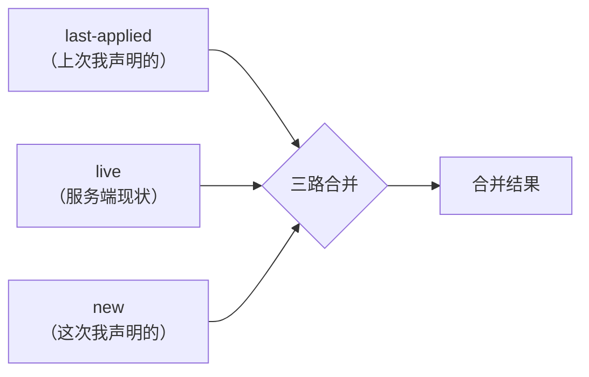

## 事故：我只是想打个标签

我们自己的系统里有一套仿 k8s 的资源层：资源有 `spec`（意图）和 `status`（事实），人用一个仿 kubectl 的 CLI 做 `apply -f xxx.yaml` 声明式写入，后台有 reconciler 持续把现实收敛到声明。

某天我要给一台节点资源（Node）打个角色标签，让它被一个组件舰队（ComponentSet）的选择器命中。YAML 长这样：

```yaml
kind: Node
metadata:
  name: node-cb227440ba8d5468
spec:
  labels:
    pool: client
```

apply 成功，标签生效，一切正常——直到第二天有人打开组网页面：这台节点的 overlay 网络显示「不启用」。

排查结论让人哭笑不得：这台节点三天前配置过 `network_profile: main`（overlay 组网声明），而我那次 apply 把它**抹掉了**。原因很简单——我们的 apply 是「读-改-写带 CAS 的全量 PUT」：YAML 里的 spec **整体替换**库里的 spec，YAML 里没有的键，就等于不存在。我只想加 labels，但「我没写 network_profile」被系统理解成了「我不要 network_profile」。

幸运的是节点侧的实际网络进程一直没倒，被抹的只是声明和展示；把 `network_profile` 补回 YAML 重新 apply 就恢复了。但这个问题必须正面回答：

> **YAML 里没写的字段，到底是「我没提」还是「我要删」？**

这个问题看着朴素，却是所有声明式系统最深的一道缝。k8s 用了整整三代机制才把它按住，而且按得并不轻松。本文把这三代机制完整拆一遍，最后聊聊：如果你也在造一个类 CRD 的系统，该怎么选。

## 问题定义：多写者共用一个对象

先把问题说精确。声明式系统的对象通常有多个写者：

- **人**（CLI/控制台）：写调度标签、改副本数、改镜像；
- **控制器 A**（比如 overlay 网络组件）：写自己管辖的 `network_profile`；
- **控制器 B**（比如心跳同步）：往 `status` 里写事实，偶尔也要修 `spec` 的某些键；
- **另一个自动化**（GitOps、定时任务）：周期性全量下发它以为的「完整声明」。

如果每次写入都是「全量替换」，那么**任何一次局部意图的表达，都会顺带清空别人写的所有字段**。上面的故事就是：人只想写 labels，却把控制器的 network_profile 清掉了。

所以真正的问题不是「怎么合并两个 map」，而是**所有权**：

1. 一个字段当前**归谁管**？
2. 我这次写入，有没有**越权**动到别人的字段？
3. 「没带」和「要删」怎么区分？

三代机制，本质是对这三个问题逐代给出更精确的回答。

## 第零代：replace——全量替换，没有答案

最原始的写动词是 `kubectl replace`（等价于 REST 的 PUT）：拿一个完整对象覆盖服务端对象。它对三个问题的回答是：

- 字段归谁管？**不管**，谁后写谁赢；
- 越权检测？**没有**；
- 「没带」还是「要删」？**不区分**，没带 = 删。

k8s 官方文档自己都标注 replace 是破坏性操作——它会把你没写的字段（包括别的控制器刚写的）全部清空。但它有一个不可替代的用途：**它是唯一语义上「干净」的写**——服务端对象被精确替换为你给的这份，没有任何合并魔法。所以三代机制并没有淘汰 replace，而是把它降级为「我知道自己在干什么」时的管理面工具。

我们的 apply 事故，就是把 replace 语义错误地当成了日常声明式写入的默认动词。

## 第一代：client-side apply——三路合并回答「没带 vs 要删」

`kubectl apply` 的第一代实现是**客户端三路合并**（client-side apply，CSA）。

机制：每次 apply 时，kubectl 把你提交的完整配置**原样存进对象的一个 annotation**：

```yaml
metadata:
  annotations:
    kubectl.kubernetes.io/last-applied-configuration: |
      {"kind":"Node","spec":{"labels":{"pool":"client"}}}
```

下次 apply 时，手里有三份数据，做一次三路 diff：



合并规则的关键在删除判定：

- 字段在 **last-applied 有、new 没有** → 是我主动删的 → **删**；
- 字段在 **live 有、last-applied 没有、new 也没有** → 不是我写的，是别人后来加的 → **原样保留**。

第二条规则直接治好了我们的事故：network_profile 不在我的 last-applied 里，也不在我的新 YAML 里，三路合并判定「这不是你管的字段」，原样不动。

**但它有三个结构性软肋：**

1. **annotation 膨胀**。last-applied 是完整配置的字符串副本，塞进 metadata annotation——大对象的 etcd 体积接近翻倍，还可能撞 256KB 的 annotation 上限。
2. **所有权是「按客户端」而不是「按字段」**。annotation 只记录「kubectl 这个客户端上次写了什么」。两个人用不同的方式写同一对象（一个用 kubectl、一个用控制台、一个用 controller），last-applied 只覆盖其中一路的视野——另一个人写的字段虽然能「幸存」，但一旦两人碰到**同一个字段**，三路合并分不清这字段到底该听谁的，最后写的那个静默胜出。
3. **合并发生在客户端**。每个客户端都要自己实现这套 diff（kubectl、各种语言的 client、GitOps 工具），语义难免漂移。

所以 k8s 官方后来把 CSA 定位为**过渡方案**：它解决了「没带 vs 要删」，但回答不了「字段归谁管」。

## 旁代：patch 家族——显式声明「我只改这几个键」

和三路合并平行发展的还有一族更直白的机制：patch。思路是干脆不让客户端提交「完整对象」，而是提交「修改意图」：

- **JSON Merge Patch（RFC 7386）**：`{"spec":{"labels":{"pool":"client"}}}`——出现的键覆盖，**`null` 显式删除**，缺席的键一律不动。语义最简单，「没带 vs 要删」用 null 区分。
- **JSON Patch（RFC 6902）**：操作列表 `[{"op":"replace","path":"/spec/replicas","value":3}]`，还带 `test` 操作可以做乐观并发断言。
- **Strategic Merge Patch（k8s 特有）**：按 Go struct 的 `patchStrategy` tag 合并——特别是**列表按键合并**（比如 containers 按 name 合并，而不是整个列表替换），这是 RFC 7386 做不到的。

patch 家族对「越权」的回答是**纪律**而非机制：我只发我要改的键，自然不会踩别人。但它管不住别人踩我——也没有任何地方记录「这个键归谁」。所以它是对工程纪律好的团队的轻量解，不是系统性答案。

## 第二代：Server-Side Apply——把所有权写进对象

真正的系统性答案在 1.16 beta、1.22 GA 的 **Server-Side Apply（SSA）**。核心是一个新的元数据字段：`metadata.managedFields`。

### managedFields：每个字段都有户口本

服务端为每个对象维护一份**字段所有权登记**：哪个 manager（kubectl、某个 controller、某个 operator）在什么时候、用什么操作（Apply/Update）管理着哪些字段——精确到字段路径，比如：

```yaml
metadata:
  managedFields:
    - manager: kubectl
      operation: Apply
      fieldsV1:
        f:spec:
          f:labels:
            f:pool: {}
    - manager: overlay-controller
      operation: Apply
      fieldsV1:
        f:spec:
          f:network_profile: {}
```

注意这个设计的精妙处：**所有权登记存放在 metadata 而不是 annotation**，由服务端维护（update/patch 也会记账），不再随客户端的 annotation 漂流。

### apply 语义因此改写

SSA 下 apply 的含义从「提交完整对象」变成「**声明我拥有哪些字段**」：

- 我带的字段 → 登记为我（manager）所有，写入；
- 我没带的字段 → **不属于本次声明，一律不碰**——不存在「没带 = 删」，要删自己拥有的字段，下次 apply 不带它即可（因为我拥有它，它的消失被理解为主动移除）；
- 我要写的字段**已属于别的 manager** → **409 Conflict**，服务端返回冲突字段路径和现任 owner：

```
Apply failed with 1 conflict: conflict with "overlay-controller":
.spec.network_profile
```

要强行接管，必须显式 `--force-conflicts`——把「越权」从静默事故变成一次需要确认的动作。

回头看我们的事故：在 SSA 语义下，我的 apply（manager= cenaclectl）去写 labels 完全合法，而如果哪天 overlay-controller 和我抢同一个字段，冲突会在**写入当场**被 409 拦住，而不是第二天在组网页面上发现。

### 配套文化：don't fight over fields

SSA 不只是一个 API 特性，它带了一条生态纪律：**每个字段有且只有一个 owner，controller 不要抢别人的字段**。controller 写对象必须用 SSA 并起唯一的 fieldManager 名；两个 controller 反复覆盖同一字段（「打架」）会被 managedFields 看得一清二楚——这在 CSA 时代是排查黑洞。

还有一层工程收益：合并挪到服务端后，任何客户端（甚至裸 curl）都能获得一致的 apply 语义，不用再各自实现三路合并。

## 第三代？不，是「另一种活法」：不可变资源

讲到这有人可能会问：还有没有更新的机制？其实近年更值得关注的是一类**回避问题**的设计——既然多写者合并这么难，那就让最难合并的那类资源**不可变**。

新鲜出炉的例子是 Google 开源的 [google/ax](https://github.com/google/ax)（声明式 agent 编排器，2026）。它刻意不站在 k8s API machinery 上，自己用 protobuf 定义资源、gRPC 做 API、Redis 存状态。面对同一个问题，它的取舍是：

- **Task 资源 create-only**：根本不存在 UpdateTask RPC，任何变更 = 删掉重建——不可变把字段合并问题**定义性删除**了；
- Workspace/Model 允许更新，但语义就是**全量替换**（和我们事故同款的坑，manifest 里没写的字段就是清空），靠「资源种类少、写者单一」的前提硬扛；
- 并发控制用 per-resource 的 Redis 悲观锁，后写全胜，无冲突检测。

AX 的选择在它自己的场景（海量短命任务、单一写者）下是成立的，但它恰好提供了一个反面对照：**只要资源是可演进的、写者多于一个，全量替换迟早咬人**——k8s 的三代机制不是过度设计，是这条路上绕不开的学费。

## 生态的现实：混用时代的坑

别以为 SSA GA 之后世界就清净了。现实是三代机制在生态里**共存**，交界处全是坑：

- **Helm 3** 用自己的三路合并（old manifest vs live vs new manifest），和 kubectl SSA 的 managedFields 互相看不见——用 Helm 装的东西再用 kubectl apply 改，两边都以为字段是自己的，冲突和「字段莫名回滚」是社区长年的 issue 常客；
- **GitOps 工具**被迫长出各种补丁：ArgoCD 有 `ServerSideApply=true` sync 选项和 `ignoreDifferences`，Flux 默认启用 SSA 并允许配置 fieldManager——它们存在的意义就是处理「外部写者不归我管」的现实；
- **CSA → SSA 迁移**本身也有学问：client-go 会做自动迁移（把 last-applied 里的字段转登到 SSA 管理下），但混用期的所有权归属一度是排查难点。

教训是普适的：**写动词可以共存，但所有权模型只能有一个**。k8s 保留 CSA 和 replace 纯粹是兼容包袱——新系统没有理由把这些包袱再背一遍。

## 自建类 CRD 系统：我们的决策框架

如果你也在造一个带资源层的系统（我们的场景：Go daemon + SQLite + 类 CRD 资源 + reconciler），前三代的地图可以压缩成这样一个决策框架：

**① 先上 merge-patch 止血（约半天）。** 加一个 PATCH 端点（RFC 7386）：出现的键覆盖、`null` 删除、缺席不动。这一步直接消除「没带 = 删」这个最大的雷，而且 admission 校验链可以完全复用。CLI 的 apply 改走 merge 语义，「删字段」用显式 `null` 表达。

**② 跳过 last-applied 三路合并。** 它要解决的「没带 vs 要删」已经被 merge-patch 的显式 null 解决；多写者碰同一字段时它的语义依旧模糊。k8s 保留它是兼容包袱，新系统不该新引入这个过渡形态——这是 k8s 用十年换来的、可以白嫖的教训。

**③ managedFields-lite 作为正道，纳入存储层演进一起做。** 不必照搬 k8s 的 fieldpath set 全家桶：简化为**顶层 spec 键 → manager** 的所有权表，写动词分 `update`（replace，管理面/兼容）和 `apply`（声明 manager + 写他人键 409 + `force` 显式抢），系统内的控制器写者各自登记 manager。事故在写入当场被 409 拦住，而不是事后在别的页面上发现。

一句话总结：**replace 留着当手术刀，merge-patch 当日常创可贴，字段所有权当免疫系统——而 last-applied 那条路，k8s 已经替你走过并立了「此路不通」的牌子。**

## 结语

「YAML 里没写的字段被谁删了」这个问题，表面是合并算法，深处是**所有权**：声明式系统的对象不是一张配置表，而是一个多方共治的文档。k8s 的三代演进——replace 的野蛮、CSA 的妥协、SSA 的登记制度——本质上是一部「如何给共治文档立户口」的历史。

而我们那台被抹掉网络配置的节点，现在已经重新挂回了 overlay 网络。事故本身半小时就修好了，但它留下的这条 BACKLOG，大概是这次事故最有价值的产出。
